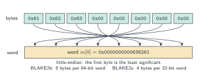
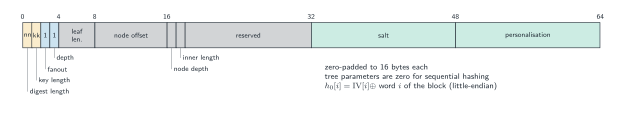
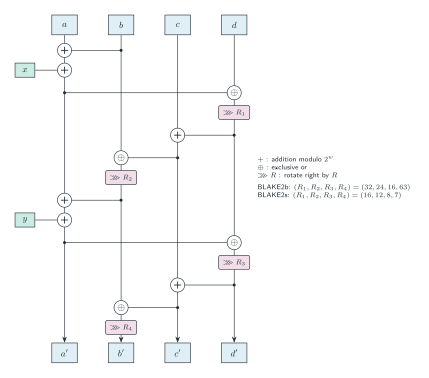
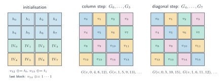
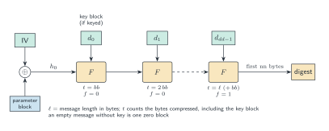

# BLAKE2

BLAKE2 is the hash function family specified in [RFC 7693], designed by Aumasson, Neves, Wilcox-O'Hearn
and Winnerlein as a faster successor to the SHA-3 finalist BLAKE [BLAKE2]. This directory specifies:

- **BLAKE2b** (64-bit words, 12 rounds) and **BLAKE2s** (32-bit words, 10 rounds) [RFC 7693, §2.1];
- the **keyed mode** (a MAC), with a key of up to one block processed as the first block [RFC 7693, §3.3];
- **salt** and **personalisation**, carried in the parameter block of the BLAKE2 specification
  [BLAKE2, §2.5]; RFC 7693 sets both to zero [RFC 7693, §2.5];
- the BLAKE2b compression function **`F` with an arbitrary number of rounds**, as exposed by
  Ethereum's precompile at address `0x09` [EIP-152].

Tree hashing (fanout, depth, leaf length, node offset, ...) is not specified: those fields of the
parameter block are fixed to sequential mode.

## Notation

| Symbol | Meaning |
|---|---|
| $`w`$ | word size in bits (64 for BLAKE2b, 32 for BLAKE2s) |
| $`x + y`$ | addition modulo $`2^w`$ |
| $`x \oplus y`$ | bitwise exclusive or |
| $`\lnot x`$ | bitwise complement |
| $`x \ggg n`$ | rotation of $`x`$ right by $`n`$ bits, $`0 < n < w`$ |
| $`\mathrm{LE}_w(b_0,\dots,b_{w/8-1})`$ | the word $`\sum_j b_j \, 2^{8j}`$ (little-endian) |

Bytes are read as $`w`$-bit words in little-endian order: the first byte of each group of
$`w/8`$ bytes is the least significant [RFC 7693, §2.4]. A 16-word message block $`m[0..15]`$ is
the little-endian decoding of a block of $`16 \cdot w/8`$ bytes; the digest is the final chain
value $`h[0..7]`$ encoded in the same order.



## Parameters

| | BLAKE2b | BLAKE2s |
|---|---|---|
| word size $`w`$ | 64 | 32 |
| rounds $`r`$ | 12 | 10 |
| block size $`bb`$ (bytes) | 128 | 64 |
| digest length $`nn`$ (bytes) | 1–64 | 1–32 |
| key length $`kk`$ (bytes) | 0–64 | 0–32 |
| salt, personalisation (bytes) | 16 each | 8 each |
| $`(R_1, R_2, R_3, R_4)`$ | $`(32, 24, 16, 63)`$ | $`(16, 12, 8, 7)`$ |
| $`IV[0..7]`$ | SHA-512 initial hash value | SHA-256 initial hash value |

The initialization vectors [RFC 7693, §2.6] are the SHA-2 initial hash values [FIPS 180-4, §5.3.3, §5.3.5]: the first 64
(BLAKE2b) or 32 (BLAKE2s) bits of the fractional parts of the square roots of the first eight
primes.

```
BLAKE2b IV: 6A09E667F3BCC908 BB67AE8584CAA73B 3C6EF372FE94F82B A54FF53A5F1D36F1
            510E527FADE682D1 9B05688C2B3E6C1F 1F83D9ABFB41BD6B 5BE0CD19137E2179
BLAKE2s IV: 6A09E667 BB67AE85 3C6EF372 A54FF53A 510E527F 9B05688C 1F83D9AB 5BE0CD19
```

The message schedule $`\sigma_0, \dots, \sigma_9`$ [RFC 7693, §2.7] consists of ten permutations of
$`\{0, \dots, 15\}`$, inherited from BLAKE. Round $`i`$ uses $`\sigma_{i \bmod 10}`$, so rounds 10
and 11 of BLAKE2b reuse $`\sigma_0`$ and $`\sigma_1`$.

```
σ0:  0  1  2  3  4  5  6  7  8  9 10 11 12 13 14 15
σ1: 14 10  4  8  9 15 13  6  1 12  0  2 11  7  5  3
σ2: 11  8 12  0  5  2 15 13 10 14  3  6  7  1  9  4
σ3:  7  9  3  1 13 12 11 14  2  6  5 10  4  0 15  8
σ4:  9  0  5  7  2  4 10 15 14  1 11 12  6  8  3 13
σ5:  2 12  6 10  0 11  8  3  4 13  7  5 15 14  1  9
σ6: 12  5  1 15 14 13  4 10  0  7  6  3  9  2  8 11
σ7: 13 11  7 14 12  1  3  9  5  0 15  4  8  6  2 10
σ8:  6 15 14  9 11  3  0  8 12  2 13  7  1  4 10  5
σ9: 10  2  8  4  7  6  1  5 15 11  9 14  3 12 13  0
```

`Constants.lean` proves, by kernel computation, that `blake2bParams.IV` and `blake2sParams.IV`
equal the SHA-512 and SHA-256 initial hash values of `Hash.SHA2` (`blake2b_IV`, `blake2s_IV`),
and that `SIGMA` has ten rows, each a permutation of `List.range 16` (`SIGMA_perm`).



## The mixing function G

$`G`$ updates four words $`v[a], v[b], v[c], v[d]`$ of the 16-word work vector with two message
words $`x, y`$ [RFC 7693, §3.1]:

```math
\begin{aligned}
v[a] &\leftarrow v[a] + v[b] + x, & v[d] &\leftarrow (v[d] \oplus v[a]) \ggg R_1, \\
v[c] &\leftarrow v[c] + v[d],     & v[b] &\leftarrow (v[b] \oplus v[c]) \ggg R_2, \\
v[a] &\leftarrow v[a] + v[b] + y, & v[d] &\leftarrow (v[d] \oplus v[a]) \ggg R_3, \\
v[c] &\leftarrow v[c] + v[d],     & v[b] &\leftarrow (v[b] \oplus v[c]) \ggg R_4.
\end{aligned}
```

The eight assignments are performed in reading order (row by row, left to right).



## The compression function F

$`F(h, m, t, f)`$ takes the chain value $`h[0..7]`$, a message block $`m[0..15]`$, a
$`2w`$-bit offset counter $`t`$ (the number of bytes processed so far, including the current
block) and a final-block flag $`f`$ [RFC 7693, §3.2]. It initialises the work vector

```math
v[0..7] = h[0..7], \qquad v[8..15] = IV[0..7],
```

```math
v[12] \leftarrow v[12] \oplus (t \bmod 2^w), \qquad
v[13] \leftarrow v[13] \oplus \lfloor t / 2^w \rfloor, \qquad
v[14] \leftarrow \lnot v[14] \text{ if } f,
```

then, for $`i = 0, \dots, r-1`$, with $`s = \sigma_{i \bmod 10}`$, applies $`G`$ to the four
columns and then the four diagonals of $`v`$ viewed as a $`4 \times 4`$ matrix:

```math
\begin{aligned}
&G(v, 0, 4, 8, 12, m[s_0], m[s_1]), && G(v, 1, 5, 9, 13, m[s_2], m[s_3]), \\
&G(v, 2, 6, 10, 14, m[s_4], m[s_5]), && G(v, 3, 7, 11, 15, m[s_6], m[s_7]), \\
&G(v, 0, 5, 10, 15, m[s_8], m[s_9]), && G(v, 1, 6, 11, 12, m[s_{10}], m[s_{11}]), \\
&G(v, 2, 7, 8, 13, m[s_{12}], m[s_{13}]), && G(v, 3, 4, 9, 14, m[s_{14}], m[s_{15}]),
\end{aligned}
```

and returns

```math
h'[i] = h[i] \oplus v[i] \oplus v[i + 8], \qquad 0 \le i < 8.
```

The reference `F` takes the number of rounds as an argument; BLAKE2 uses $`r = 12`$ (BLAKE2b) or
$`r = 10`$ (BLAKE2s).



## The hash

**Parameter block.** The initial chain value is $`h_0 = IV \oplus P`$, where $`P`$ is the
$`8 \cdot w/8`$-byte parameter block read as eight little-endian words [RFC 7693, §2.5; BLAKE2, §2.5]. As
specified here (`Reference.paramBlock`), $`P`$ is

| Bytes (BLAKE2b) | Bytes (BLAKE2s) | Field | Value |
|---|---|---|---|
| 0 | 0 | digest length | $`nn`$ |
| 1 | 1 | key length | $`kk`$ |
| 2 | 2 | fanout | 1 |
| 3 | 3 | depth | 1 |
| 4–31 | 4–15 | leaf length, node offset, node depth, inner length, reserved | 0 |
| 32–47 | 16–23 | salt | zero-padded |
| 48–63 | 24–31 | personalisation | zero-padded |

With empty salt and personalisation this is the parameter block of RFC 7693, under which only
the first word differs from the IV: $`h_0[0] = IV[0] \oplus \texttt{0x01010000} \oplus (kk \ll 8) \oplus nn`$
[RFC 7693, §3.3].

**Data blocks** [RFC 7693, §3.3]. Let $`ll`$ be the message length in bytes. If $`kk > 0`$, the key,
zero-padded to $`bb`$ bytes, is the first block. The message, zero-padded to a multiple of
$`bb`$ bytes, follows. If the result is empty ($`kk = 0`$ and $`ll = 0`$), there is a single
all-zero block. There is no length or `1`-bit padding: padding is unambiguous because the
counter $`t`$ records the number of genuine bytes. Call the blocks $`d_0, \dots, d_{dd-1}`$.

**Compression.** For $`i < dd - 1`$,
$`h_{i+1} = F(h_i, d_i, (i+1)\cdot bb, \mathsf{false})`$. The last block is compressed with the
final flag set and the counter equal to the number of data bytes, including the key block:

```math
h_{dd} = F\bigl(h_{dd-1},\ d_{dd-1},\ t_{\mathrm{last}},\ \mathsf{true}\bigr), \qquad
t_{\mathrm{last}} = \begin{cases} ll & kk = 0, \\ ll + bb & kk > 0. \end{cases}
```

**Output.** The digest is the first $`nn`$ bytes of the little-endian encoding of
$`h_{dd}[0..7]`$.



## EIP-152

[EIP-152] adds a precompile at address `0x09` computing the BLAKE2b compression function with
a caller-chosen number of rounds, for interoperability with Zcash. Its input is exactly 213 bytes:

| Bytes | Field | Encoding |
|---|---|---|
| 0–3 | rounds | 32-bit big-endian |
| 4–67 | $`h[0..7]`$ | 64-bit little-endian words |
| 68–195 | $`m[0..15]`$ | 64-bit little-endian words |
| 196–211 | $`t_0, t_1`$ | 64-bit little-endian words |
| 212 | $`f`$ | `0x00` or `0x01` |

The output is $`F(h, m, t_0 + 2^{64} t_1, f)`$ with the given number of rounds, as eight
little-endian words (64 bytes). Any other input length, or a final-flag byte other than 0 or 1,
is an error. The round count may be any value in $`[0, 2^{32} - 1]`$, including 0, and the
rounds continue the schedule $`\sigma_{i \bmod 10}`$.

## Security notes

- The BLAKE2 paper explains the changes from BLAKE, including the reduced round counts, and
  their security margin [BLAKE2].
- Guo, Karpman, Nikolić, Wang and Wu analyse the permutation and compression function, with
  results on reduced rounds; they also show that the compression function would admit
  collisions under an improper initialization, which the specified IV avoids [Guo+ 2014].
- Luykx, Mennink and Neves show that the BLAKE2 compression function is indifferentiable from a
  random function in a weakly ideal cipher model, so that none of BLAKE2's modes has a
  generic attack [LMN 2016].
- The final flag distinguishes the last compression, so BLAKE2 digests do not admit the
  length-extension attack of plain Merkle–Damgård hashes, and keyed BLAKE2 is a MAC without the
  nested construction of HMAC [BLAKE2].
- The EIP-152 `F` with fewer than 12 rounds is not BLAKE2 and carries no security claim.

## Assurance

The evidence that the Lean specification is the BLAKE2 of RFC 7693, as of 2026-10-12:

| Evidence | Status |
|----------|--------|
| Reference transcription | `Hash.BLAKE2.Reference`, for both word sizes and any number of rounds, each definition citing its section of RFC 7693 or of the BLAKE2 specification (parameter block). |
| Constants | The IVs are proved equal to the SHA-2 initial hash values, and each row of `SIGMA` is proved a permutation. |
| Fast = reference | Proved for BLAKE2b and BLAKE2s with every key of at most one block, salt, personalisation and output length (`Hash.BLAKE2.blake2bWith_eq`, `Hash.BLAKE2.blake2sWith_eq`), and for the EIP-152 compression function with any number of rounds (`Hash.BLAKE2.blake2bF_eq`). Streaming equals one-shot, for every way of splitting the message and every key of at most one block (`Hash.blake2bInit_eq`, `Hash.blake2sInit_eq`). The axiom audit shows only `propext`, `Classical.choice` and `Quot.sound`. |
| Known-answer tests | All 1024 keyed and unkeyed vectors of the BLAKE2 team's `blake2-kat.json` pass, and again through the streaming interface in five splitting patterns; EIP-152 test vectors 0–7 pass (vector 8, with $2^{32} − 1$ rounds, is skipped as too slow). Kernel-checked examples cover RFC 7693 Appendices A and B and EIP-152 vector 5. |
| Differential testing | Every message length up to 385 bytes with several key lengths, every output length, a 1 MiB message, random parameters, messages and streaming splits agree with `blake2b_simd`/`blake2s_simd` and RustCrypto `blake2`. The precompile agrees with `revm-precompile` and the `eip-152` crate on round counts 0–100, random inputs and invalid inputs. |
| Fuzzing | Three `cargo-fuzz` targets (one-shot with parameters, streaming, and the precompile on raw inputs); no divergence has been found. The roadmap's budget of $10^9$ executions per oracle has not yet been reached. |
| Other formal specifications | HACL* and hacspec (F*), Cryptol and ACL2 specify BLAKE2, and Verifereum (HOL4) the EIP-152 $F$ (informational; see `LIT-REVIEW.md`). |
| Known deviations | Keys longer than one block are outside RFC 7693 and outside the equivalence theorems. The tree-hashing parameters of the BLAKE2 specification are fixed to sequential mode. |

## In this directory

| File | Contents |
|---|---|
| `Reference.lean` | `Params`, `SIGMA`; `Reference.wordsLE`, `bytesLE`, `G`, `round`, `F`, `paramBlock`, `blocks`, `hash` on `BitVec w` and `List UInt8`; `blake2bParams`, `blake2sParams` |
| `Constants.lean` | `blake2b_IV`, `blake2s_IV`, `SIGMA_perm` |
| `Fast.lean` | executable BLAKE2 on `ByteArray`, generic over the `Fast.Word` class with `UInt64`/`UInt32` instances: `Fast.G`, `round`, `F`, `block`, `paramBlock`, `pad`, `hashWith` |
| `Stream.lean` | incremental interface `Fast.State` with `init`, `update`, `finalize` |
| `API.lean` | `Hash.blake2bWith`, `blake2sWith`, `blake2b` (512-bit, unkeyed), `blake2s` (256-bit, unkeyed), `blake2bInit`, `blake2sInit`, `blake2bF`, `blake2bPrecompile` |
| `Equiv.lean` | `LawfulWord`, `Params.Valid`, and the proofs that the fast specification equals the reference |
| `StreamLemmas.lean` | the proof that the streaming interface equals the one-shot functions |

Main theorems (namespace `Hash.BLAKE2`):

- `blake2bWith_eq`, `blake2sWith_eq`: for every key with `key.size ≤ 128` (resp. `≤ 64`), i.e.
  at most one block, and every salt, personalisation, output length `nn` and message, the bytes
  of `blake2bWith` (resp. `blake2sWith`) are `Reference.hash` with `blake2bParams`
  (resp. `blake2sParams`). The hypothesis on the key is weaker than the standard's limit of
  $`bb/2`$ bytes; no hypothesis is placed on `nn`, salt or personalisation lengths.
- `blake2b_eq`, `blake2s_eq`: the unkeyed BLAKE2b-512 and BLAKE2s-256 equal the reference.
- `blake2bF_eq`: for any number of rounds, `blake2bF rounds h m t0 t1 f` is `Reference.F` with
  $`t = t_0 + 2^{64} t_1`$. Arrays of any length are allowed; the parsing in
  `blake2bPrecompile` is not itself covered by a theorem.
- `Equiv.hashWith_eq`, `Equiv.F_eq`: the generic versions, for any `Params` satisfying
  `Params.Valid` (whole-byte words, rotations shorter than a word, 16-word blocks, 8-word IV,
  parameter-block layout) and any `LawfulWord` instance; `blake2bParams_valid` and
  `blake2sParams_valid` discharge the first hypothesis.

- `blake2bInit_eq`, `blake2sInit_eq` (namespace `Hash`): feeding any list of pieces `ms` to the
  streaming interface from `blake2bInit key salt personal nn` (resp. `blake2sInit`), then
  `finalize`, gives `blake2bWith` (resp. `blake2sWith`) of their concatenation, for every key of
  at most one block. The generic version is `Fast.State.finalize_updates`. The proof's invariant:
  the state has compressed the first $`c`$ whole blocks of the data (key block, then message)
  with the one-shot counters, and buffers the remaining 1 to $`bb`$ bytes, or none before any
  data.

The streaming interface is also tested: by `blake2-kat.json` records split at several points
(`HashKAT`) and by fuzzing with random splits (`harness/`). Kernel-checked examples in `HashTests/BLAKE2.lean` cover RFC 7693
Appendices A and B, the first keyed `blake2-kat.json` vector and EIP-152 test vector 5.

The reference is total: it does not reject out-of-range inputs. Digest and key lengths enter the
parameter block modulo 256, longer salt or personalisation strings are truncated, and `nn` larger
than $`8 \cdot w/8`$ yields $`8 \cdot w/8`$ bytes. Callers must respect the ranges in
[Parameters](#parameters) to obtain standard BLAKE2.

## References

- **[RFC 7693]** M-J. Saarinen and J-P. Aumasson, *The BLAKE2 Cryptographic Hash and Message Authentication
   Code (MAC)*, RFC 7693, 2015. doi:[10.17487/RFC7693](https://doi.org/10.17487/RFC7693),
   <https://www.rfc-editor.org/rfc/rfc7693>.
- **[BLAKE2]** J-P. Aumasson, S. Neves, Z. Wilcox-O'Hearn and C. Winnerlein, *BLAKE2: Simpler, Smaller, Fast
   as MD5*, Applied Cryptography and Network Security (ACNS 2013), LNCS 7954, pp. 119–135, 2013.
   doi:[10.1007/978-3-642-38980-1_8](https://doi.org/10.1007/978-3-642-38980-1_8). Specification:
   <https://www.blake2.net/blake2.pdf>.
- **[EIP-152]** T. Hess, M. Luongo, P. Dyraga and J. Hancock, *EIP-152: Add BLAKE2 compression function `F`
   precompile*, Ethereum Improvement Proposal 152, 2016.
   <https://eips.ethereum.org/EIPS/eip-152>.
- **[FIPS 180-4]** NIST, *Secure Hash Standard (SHS)*, FIPS PUB 180-4, 2015.
   doi:[10.6028/NIST.FIPS.180-4](https://doi.org/10.6028/NIST.FIPS.180-4).
- **[Guo+ 2014]** J. Guo, P. Karpman, I. Nikolić, L. Wang and S. Wu, *Analysis of BLAKE2*, Topics in
   Cryptology – CT-RSA 2014, LNCS 8366, 2014. <https://eprint.iacr.org/2013/467>.
- **[LMN 2016]** A. Luykx, B. Mennink and S. Neves, *Security Analysis of BLAKE2's Modes of Operation*, IACR
   Transactions on Symmetric Cryptology 2016(1), pp. 158–176, 2016.
   doi:[10.13154/tosc.v2016.i1.158-176](https://doi.org/10.13154/tosc.v2016.i1.158-176).
