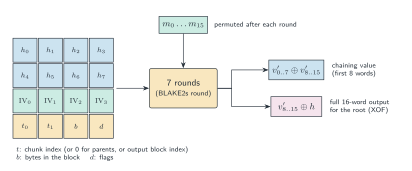
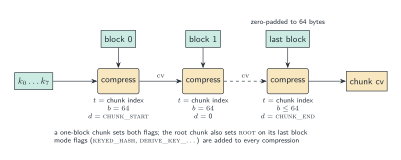
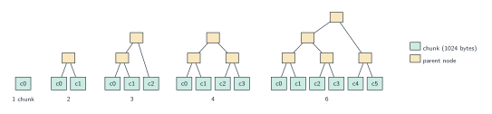
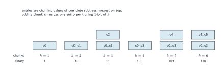
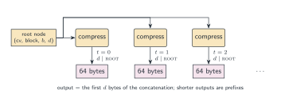

# BLAKE3

BLAKE3 is the hash function specified by O'Connor, Aumasson, Neves and Wilcox-O'Hearn
[BLAKE3]. It keeps the compression function of BLAKE2s [BLAKE2, RFC7693], reduced from 10 to
7 rounds, and replaces BLAKE2's sequential mode with a binary tree over 1024-byte chunks
[BLAKE3, §2.1]. One function provides three modes [BLAKE3, §2.3]:

| Mode         | Key words $k$                     | Mode flags                                 |
|--------------|-----------------------------------|--------------------------------------------|
| `hash`       | the IV                            | none                                       |
| `keyed_hash` | the 32-byte key                   | `KEYED_HASH`                               |
| `derive_key` | the hash of the context string    | `DERIVE_KEY_CONTEXT`, then `DERIVE_KEY_MATERIAL` |

Every mode is an extendable-output function: the root node can be expanded to any number of
output bytes, and the default output length is 32 bytes [BLAKE3, §2.6]. BLAKE3 has no NIST or
IETF standard; the specification and the BLAKE3 team's reference implementation define it.

This directory is a Lean 4 specification of BLAKE3: a reference transcription of
[BLAKE3, §2] (`Reference.lean`), an executable version (`Fast.lean`) proved equal to it, and a
streaming interface proved equal to one-shot hashing.

## Notation

- A *word* is a 32-bit unsigned integer, `BitVec 32` in the reference and `UInt32` in the fast
  version. $+$ is addition modulo $2^{32}$, $\oplus$ is bitwise exclusive or, and
  $x \ggg r$ is rotation right by $r$ bits.
- Bytes are read into words and words are written out as bytes in **little-endian** order
  [BLAKE3, §2.4]: the bytes $b_0, b_1, b_2, b_3$ give the word
  $b_0 + 2^8 b_1 + 2^{16} b_2 + 2^{24} b_3$.
- A *block* is 64 bytes (16 words) and a *chunk* is 1024 bytes (16 blocks).
- A *chaining value* (CV) is 8 words. $\mathrm{first}_8(x)$ is the first 8 words of $x$.
- Flags are combined with bitwise or, written $|$.

## Parameters

The IV is that of BLAKE2s, which is the SHA-256 initial hash value [BLAKE3, §2.2, Table 1]:

| $\mathrm{IV}_0$ | $\mathrm{IV}_1$ | $\mathrm{IV}_2$ | $\mathrm{IV}_3$ | $\mathrm{IV}_4$ | $\mathrm{IV}_5$ | $\mathrm{IV}_6$ | $\mathrm{IV}_7$ |
|---|---|---|---|---|---|---|---|
| `6A09E667` | `BB67AE85` | `3C6EF372` | `A54FF53A` | `510E527F` | `9B05688C` | `1F83D9AB` | `5BE0CD19` |

The message permutation $\pi$ [BLAKE3, §2.2, Table 2]:

| $i$      | 0 | 1 | 2 | 3 | 4 | 5 | 6 | 7 | 8 | 9 | 10 | 11 | 12 | 13 | 14 | 15 |
|----------|---|---|---|---|---|---|---|---|---|---|----|----|----|----|----|----|
| $\pi(i)$ | 2 | 6 | 3 | 10 | 7 | 0 | 4 | 13 | 1 | 11 | 12 | 5 | 9 | 14 | 15 | 8 |

The domain-separation flags [BLAKE3, §2.2, Table 3]:

| Flag | In Lean | Value | Set on |
|---|---|--:|---|
| `CHUNK_START` | `Flag.chunkStart` | 1 | the first block of each chunk |
| `CHUNK_END` | `Flag.chunkEnd` | 2 | the last block of each chunk |
| `PARENT` | `Flag.parent` | 4 | parent nodes |
| `ROOT` | `Flag.root` | 8 | the root compressions (output) |
| `KEYED_HASH` | `Flag.keyedHash` | 16 | every compression of `keyed_hash` |
| `DERIVE_KEY_CONTEXT` | `Flag.deriveKeyContext` | 32 | every compression of the first stage of `derive_key` |
| `DERIVE_KEY_MATERIAL` | `Flag.deriveKeyMaterial` | 64 | every compression of the second stage of `derive_key` |

Sizes: `CHUNK_LEN` $= 1024$ bytes [BLAKE3, §2.1], `BLOCK_LEN` $= 64$ bytes [BLAKE3, §2.4]
(`chunkLen`, `blockLen` in Lean).
The compression function has 7 rounds [BLAKE3, §2.2].

## The compression function

$\mathrm{compress}(h, m, t, b, d)$ takes a chaining value $h_0,\dots,h_7$, a message block
$m_0,\dots,m_{15}$, a 64-bit counter $t$, the number of bytes $b \le 64$ in the block and the
flags $d$, and returns 16 words [BLAKE3, §2.2].

**Initialisation.** The state is the 16 words

$$v = (h_0, \dots, h_7,\ \mathrm{IV}_0, \mathrm{IV}_1, \mathrm{IV}_2, \mathrm{IV}_3,\ t_{\mathrm{lo}},\ t_{\mathrm{hi}},\ b,\ d),
\qquad t_{\mathrm{lo}} = t \bmod 2^{32},\quad t_{\mathrm{hi}} = \lfloor t / 2^{32} \rfloor .$$

**Rounds.** Seven rounds are applied. Each is the BLAKE2s round [RFC7693, §3.2] with the
message words taken in order (the schedule $\sigma_0$, the identity): the mixing function
$G_{a,b,c,d}(x, y)$ on the columns, then the diagonals,

$$G_{0,4,8,12}(m_0,m_1),\ G_{1,5,9,13}(m_2,m_3),\ G_{2,6,10,14}(m_4,m_5),\ G_{3,7,11,15}(m_6,m_7),$$
$$G_{0,5,10,15}(m_8,m_9),\ G_{1,6,11,12}(m_{10},m_{11}),\ G_{2,7,8,13}(m_{12},m_{13}),\ G_{3,4,9,14}(m_{14},m_{15}),$$

where $G$ [RFC7693, §3.1] with the BLAKE2s rotations $(16, 12, 8, 7)$ is

$$\begin{aligned}
v_a &\leftarrow v_a + v_b + x, & v_d &\leftarrow (v_d \oplus v_a) \ggg 16, & v_c &\leftarrow v_c + v_d, & v_b &\leftarrow (v_b \oplus v_c) \ggg 12,\\
v_a &\leftarrow v_a + v_b + y, & v_d &\leftarrow (v_d \oplus v_a) \ggg 8,  & v_c &\leftarrow v_c + v_d, & v_b &\leftarrow (v_b \oplus v_c) \ggg 7.
\end{aligned}$$

Between rounds the message words are permuted, $m_i \leftarrow m_{\pi(i)}$. (The reference
permutes after all seven rounds and discards the last permuted block, which is equivalent.)

**Output.** For $0 \le i < 8$,

$$\mathrm{out}_i = v_i \oplus v_{i+8}, \qquad \mathrm{out}_{i+8} = v_{i+8} \oplus h_i .$$

The first eight words are the next chaining value; all sixteen are used only by the root's
output [BLAKE3, §2.2, §2.6]. The Lean reference reuses `Hash.BLAKE2.Reference.round` with the
BLAKE2s parameters and round index 0, whose `SIGMA[0]` is the identity.



## Chunks

The input is split into chunks of 1024 bytes, the last possibly shorter; an empty input is a
single empty chunk [BLAKE3, §2.1]. Chunk $j$ (counting from 0) is split into
$n = \max(1, \lceil |C| / 64 \rceil)$ blocks $B_0, \dots, B_{n-1}$, the last zero-padded to 64
bytes; an empty chunk has one empty block [BLAKE3, §2.4]. With key words $k$ and mode flags
$f$, the blocks are compressed in order, every one with counter $t = j$:

$$c_0 = k, \qquad c_{i+1} = \mathrm{first}_8\bigl(\mathrm{compress}(c_i, B_i, j, 64, f \mid s_i)\bigr) \quad (0 \le i < n - 1),$$

where $s_i$ is `CHUNK_START` if $i = 0$ and $0$ otherwise. The last block is the chunk's *node*:
the inputs $(c_{n-1}, B_{n-1}, j, |B_{n-1}|, f \mid s_{n-1} \mid e)$ of its final compression,
where $e$ is `CHUNK_END` and $|B_{n-1}|$ is the unpadded length. A one-block chunk sets both
`CHUNK_START` and `CHUNK_END`. The chunk's chaining value is $\mathrm{first}_8$ of that
compression, unless the chunk is the root (a single-chunk input), see below.

In Lean the node is the structure `Output` (`cv`, `block`, `counter`, `blockLen`, `flags`):
the compression is deferred because the root is compressed differently.



## The tree

The chunks are the leaves of a binary tree in which every left subtree is complete, with a
power of 2 leaves, and at least as large as its right sibling [BLAKE3, §2.1]. Equivalently, a
tree over $n \ge 2$ chunks has

$$\mathrm{leftLeaves}(n) = 2^{\lfloor \log_2 (n-1) \rfloor}$$

chunks on the left, the largest power of 2 strictly less than $n$, and the rest on the right
(`Hash.Tree.leftLeaves`). The chunk indices, and hence the counters, run left to right over
the whole input.

A parent node with children's chaining values $l, r$ compresses the 64-byte block $l \parallel r$
from the key words [BLAKE3, §2.5]:

$$\text{node} = (k,\ l \parallel r,\ t = 0,\ b = 64,\ f \mid \texttt{PARENT}),$$

and its chaining value is $\mathrm{first}_8$ of that compression. The root node is the node
of the top of the tree: the single chunk if $n = 1$, otherwise the top parent. Only the root
is compressed with `ROOT`.

`Hash.Tree.root` defines the tree generically over leaf, node and chaining-value types.

**Incremental hashing.** A streaming implementation does not know which chunk is last, so it
keeps a stack of chaining values of complete subtrees [BLAKE3, §5.1.2, Listing 1]. After the
chunk with index $i$ is complete, with $\mathrm{total} = i + 1$ chunks so far:

```
new_cv := cv(chunk i)
while total is even:
    new_cv := cv(parent(stack.pop(), new_cv)); total := total / 2
stack.push(new_cv)
```

A chunk is pushed only once at least one more byte of input arrives, so the last chunk is
always held back. At the end, the last chunk's node is merged with every stack entry, newest
first, to give the root node (`Hash.Tree.merge`, `Hash.Tree.finish`).

Why this gives the same root (`Hash.Tree.finish_pushAll`, following [BLAKE3, §5.1.2]): after
$k$ chunks the stack holds one complete subtree per 1-bit of $k$; reading $k$ from its lowest
1-bit $2^v$, the top entry covers the last $2^v$ chunks, and so on (`blocks`). Adding a chunk
merges one subtree per trailing 1-bit of $k$ (`merge_blocks`). At the end, the subtrees are
merged from the smallest; each subtree is larger than everything to its right, so each merge
is a node of the tree defined by the `leftLeaves` rule (`finish_blocks`).





## Output (XOF)

The root node $(c, B, t, b, d)$ is expanded by compressing it with `ROOT` set and the counter
replaced by $0, 1, 2, \dots$ [BLAKE3, §2.6]. Each compression gives all 16 output words, 64
bytes in little-endian order, and the first $\ell$ bytes are the output:

$$\mathrm{out}(\ell) = \mathrm{first}_{\ell\ \text{bytes}}\Bigl(\mathrm{LE}\bigl(\mathrm{compress}(c, B, 0, b, d \mid \texttt{ROOT})\bigr) \parallel \mathrm{LE}\bigl(\mathrm{compress}(c, B, 1, b, d \mid \texttt{ROOT})\bigr) \parallel \cdots\Bigr).$$

The output stream does not depend on $\ell$, so a shorter output is a prefix of a longer one
(`blake3Xof_prefix`). The specification bounds the output at $2^{64}$ bytes; the Lean
definitions take any $\ell$ and reduce the counter modulo $2^{64}$.



## Modes

With $\mathrm{BLAKE3}_{k,f}(M, \ell)$ the construction above (`Reference.hashWith`)
[BLAKE3, §2.3]:

- **`hash`**: $\mathrm{BLAKE3}_{\mathrm{IV},\,0}(M, \ell)$.
- **`keyed_hash`**: $\mathrm{BLAKE3}_{K,\,f}(M, \ell)$ with $f$ = `KEYED_HASH`, where $K$ is
  the 32-byte key read as 8 little-endian words.
- **`derive_key`**: two stages. First, the context string $C$ is hashed to a 32-byte
  context key $K_C = \mathrm{BLAKE3}_{\mathrm{IV},\,f_1}(C, 32)$ with $f_1$ =
  `DERIVE_KEY_CONTEXT`; then the key material $M$ is hashed as
  $\mathrm{BLAKE3}_{K_C,\,f_2}(M, \ell)$ with $f_2$ = `DERIVE_KEY_MATERIAL`, $K_C$ read as 8
  little-endian words. The context string is meant to be hard-coded and globally unique
  [BLAKE3, §6.2]; this library takes it as bytes, which the caller encodes as UTF-8.

## Security notes

These notes summarise the specification; this directory proves no security properties.

- **Goals.** 128-bit security against preimage, second-preimage, collision and
  differentiability attacks, with 256-bit keys [BLAKE3, §4.1].
- **Mode.** The specification argues that the tree mode satisfies the conditions for sound
  tree hashing of Bertoni et al. [SOUND]: it is subtree-free thanks to the `ROOT` flag,
  radically decodable and message-complete. With the indifferentiability of the truncated
  compression function this gives the bound of [BLAKE3, §4.3]; the specification also discusses
  the untruncated root output and the feed-forward [BLAKE3, §4.2, §4.3].
- **Rounds.** The reduction from 10 to 7 rounds rests on the cryptanalysis of BLAKE and
  BLAKE2 summarised in [BLAKE3, §4.4], including [GKNWW14].
- **Length extension.** Only the root sets `ROOT`, so an output cannot be extended into the
  output of a longer input [BLAKE3, §4.3].

## Assurance

The evidence that the Lean specification is the BLAKE3 of its specification, as of
2026-10-12:

| Evidence | Status |
|----------|--------|
| Reference transcription | `Hash.BLAKE3.Reference` and `Hash.Construction.Tree`, each definition citing its section of the specification. |
| Constants | The IV is the BLAKE2s IV, proved equal to the SHA-256 initial hash value. |
| Fast = reference | Proved for all three modes with every output length (`Hash.BLAKE3.blake3Xof_eq`, `Hash.BLAKE3.blake3Keyed_eq` for 32-byte keys, `Hash.BLAKE3.blake3DeriveKey_eq`). The axiom audit shows only `propext`, `Classical.choice` and `Quot.sound`. |
| Streaming = one-shot | Proved for every key, mode, output length and split of the input (`Hash.BLAKE3.Fast.State.finalize_updates`), from the generic theorem that the chaining-value stack computes the tree (`Hash.Tree.finish_pushAll`). Shorter outputs are proved to be prefixes of longer ones (`Hash.BLAKE3.blake3Xof_prefix`). |
| Known-answer tests | All 35 cases of the BLAKE3 team's `test_vectors.json` pass in all three modes, at the full 131 bytes and at 32 bytes, one-shot and through the streaming interface in eight splitting patterns (`lake exe hash-kat`). Kernel-checked examples cover the three modes on the empty input and `hash` on 1 and 65 bytes. |
| Differential testing | Every input length up to 2049 bytes and a sample up to 16 KiB, output lengths around the 64-byte blocks, a 1 MiB input, random inputs, keys, contexts and streaming splits agree with the `blake3` crate and the BLAKE3 team's reference implementation. |
| Fuzzing | Two `cargo-fuzz` targets (all modes one-shot, and streaming); no divergence has been found. The roadmap's budget of $10^9$ executions per oracle has not yet been reached. |
| Other formal specifications | `clean` (Verified-zkEVM) has a Lean 4 specification of BLAKE3 with circuit gadgets (informational; see `LIT-REVIEW.md`). |
| Known deviations | `Hash.blake3DeriveKey` takes the context string as bytes; the specification intends a hard-coded string, which the caller encodes as UTF-8. |

## In this directory

| File | Contents |
|------|----------|
| `Reference.lean` | Constants (`IV`, `msgPermutation`, the flags `Flag.*`, `chunkLen`, `blockLen`) and the reference specification on `BitVec 32` and `List UInt8`: `compress`, `Output` with `chainingValue` and `rootBytes`, `chunkOutput`, `parentOutput`, `inputChunks`, `hashWith`, and the modes `hash`, `keyedHash`, `deriveKey`. |
| `Fast.lean` | The executable version on `ByteArray` and `Array UInt32`, step by step as the reference: `compress`, `chunkOutput` on one zero-padded copy of the chunk, `rootOutput`, `hashWith`, `ivWords`, `keyWords`. |
| `Stream.lean` | Streaming state `State` (key, flags, CV stack, chunk count, buffered current chunk) with `init`, `update`, `rootOutput`, `finalize` [BLAKE3, §5.1]. |
| `API.lean` | Byte-level API: `Hash.blake3Xof`, `Hash.blake3` (32 bytes), `Hash.blake3Keyed`, `Hash.blake3DeriveKey`, and the streaming initial states `blake3Init`, `blake3KeyedInit`, `blake3DeriveKeyInit`. |
| `Equiv.lean` | Fast equals reference, and output prefix consistency. |
| `StreamLemmas.lean` | Streaming equals one-shot, through the invariant `Inv`. |
| `../Construction/Tree.lean` | The generic tree: `leftLeaves`, `root`; the CV stack: `merge`, `addLeaf`, `pushAll`, `finish`. |
| `../Construction/TreeLemmas.lean` | The CV stack computes the tree; `root` commutes with a change of representation. |

Main theorems:

| Theorem | Statement |
|---------|-----------|
| `Hash.BLAKE3.Equiv.compress_eq` | The fast compression function computes the reference one. |
| `Hash.BLAKE3.Equiv.hashWith_eq` | `Fast.hashWith` equals `Reference.hashWith` for every key, flags, input and output length. |
| `Hash.BLAKE3.blake3Xof_eq`, `Hash.BLAKE3.blake3_eq` | `blake3Xof m d` (resp. `blake3 m`) equals `Reference.hash m d` (resp. with $d = 32$). |
| `Hash.BLAKE3.blake3Keyed_eq` | `blake3Keyed` equals `Reference.keyedHash` for every 32-byte key. |
| `Hash.BLAKE3.blake3DeriveKey_eq` | `blake3DeriveKey` equals `Reference.deriveKey`. |
| `Hash.BLAKE3.Equiv.rootBytes_prefix`, `Hash.BLAKE3.blake3Xof_prefix` | For $d_1 \le d_2$, the $d_1$-byte output is the first $d_1$ bytes of the $d_2$-byte output. |
| `Hash.Tree.finish_pushAll` | Pushing all chunks but the last onto the CV stack, then finishing with the last chunk's node, gives `Tree.root`. |
| `Hash.Tree.root_map` | `Tree.root` commutes with a representation change that commutes with leaf, parent and CV. |
| `Hash.BLAKE3.Fast.State.finalize_updates` | Folding `update` over pieces `ms` from `init key flags`, then `finalize d`, equals `hashWith key flags` of their concatenation. |
| `Hash.blake3Init_eq`, `Hash.blake3KeyedInit_eq`, `Hash.blake3DeriveKeyInit_eq` | The same for the three byte-level modes. |

The BLAKE2s round equivalence used by `compress_eq` is `Hash.BLAKE2.Equiv.round_eq`; the IV is
proved equal to the SHA-256 initial hash value in `Hash.BLAKE2.Constants` (`blake2s_IV`). The testing
evidence (known-answer tests, differential testing, fuzzing) is under [Assurance](#assurance).

## References

1. **[BLAKE3]** J. O'Connor, J-P. Aumasson, S. Neves, Z. Wilcox-O'Hearn. *BLAKE3: One
   Function, Fast Everywhere*. Specification, 2020.
   <https://github.com/BLAKE3-team/BLAKE3-specs/blob/master/blake3.pdf>
2. **[RFC7693]** M-J. O. Saarinen, J-P. Aumasson. *The BLAKE2 Cryptographic Hash and Message
   Authentication Code (MAC)*. RFC 7693, 2015. <https://www.rfc-editor.org/rfc/rfc7693>
3. **[BLAKE2]** J-P. Aumasson, S. Neves, Z. Wilcox-O'Hearn, C. Winnerlein. *BLAKE2: Simpler,
   Smaller, Fast as MD5*. ACNS 2013, LNCS 7954, pp. 119–135.
   <https://doi.org/10.1007/978-3-642-38980-1_8>
4. **[GKNWW14]** J. Guo, P. Karpman, I. Nikolić, L. Wang, S. Wu. *Analysis of BLAKE2*. CT-RSA
   2014, LNCS 8366. <https://eprint.iacr.org/2013/467>
5. **[SOUND]** G. Bertoni, J. Daemen, M. Peeters, G. Van Assche. *Sufficient Conditions for
   Sound Tree and Sequential Hashing Modes*. International Journal of Information Security
   13(4), 2014, pp. 335–353. <https://doi.org/10.1007/s10207-013-0220-y>
