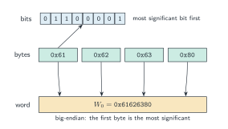
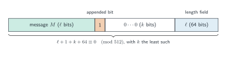
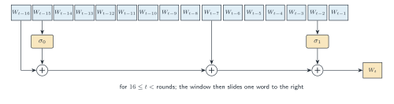
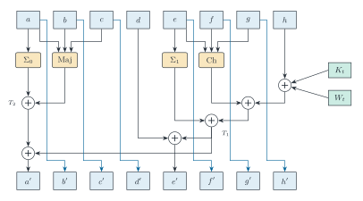
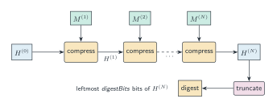

# SHA-2

SHA-2 is the family of hash functions specified by NIST in the *Secure Hash Standard* [FIPS 180-4]. Every member is a Merkle–Damgård iteration [Merkle 1989; Damgård 1989] of a compression function
built from additions, bitwise operations, rotations and shifts on $w$-bit words. The members with
32-bit words are SHA-224 and SHA-256 [FIPS 180-4, §6.3, §6.2]; those with 64-bit words are SHA-384,
SHA-512, SHA-512/224 and SHA-512/256 [FIPS 180-4, §6.5, §6.4, §6.6, §6.7]. This directory provides all
six. It contains a reference specification that follows the standard, an executable
specification on byte arrays, and a proof that the two agree. Section numbers such as §6.2.2
refer to FIPS 180-4.

## Notation

Messages, words and digests follow the data model of [FIPS 180-4, §2.1, §3.1].

- $w \in \lbrace 32, 64 \rbrace$ is the word size. A *word* is a $w$-bit string; in Lean it is a
  `BitVec w` (reference) or a `UInt32`/`UInt64` (fast).
- $x \wedge y$, $x \oplus y$ and $\neg x$ are bitwise AND, XOR and complement.
- $x + y$ is addition modulo $2^w$ [FIPS 180-4, §3.2].
- $\mathrm{SHR}^n(x) = x \gg n$ is the right shift [FIPS 180-4, §3.2 (3)].
- $\mathrm{ROTR}^n(x) = (x \gg n) \vee (x \ll (w - n))$ is the right rotation, for
  $0 \le n < w$ [FIPS 180-4, §3.2 (4)].
- **Bit and byte order.** A message is a bit string. A byte is read most significant bit
  first, so `0x61` is `01100001`. Words are big-endian: the first bit (or byte) of a word is its
  most significant. Integers such as the message length are written big-endian too [FIPS 180-4, §3.1].

## Parameters

| Member      | $w$ | Block $m$ | Length field | Rounds | Digest | $H^{(0)}$ |
|-------------|-----|-----------|--------------|--------|--------|-----------|
| SHA-224     | 32  | 512       | 64           | 64     | 224    | §5.3.2    |
| SHA-256     | 32  | 512       | 64           | 64     | 256    | §5.3.3    |
| SHA-384     | 64  | 1024      | 128          | 80     | 384    | §5.3.4    |
| SHA-512     | 64  | 1024      | 128          | 80     | 512    | §5.3.5    |
| SHA-512/224 | 64  | 1024      | 128          | 80     | 224    | §5.3.6.1  |
| SHA-512/256 | 64  | 1024      | 128          | 80     | 256    | §5.3.6.2  |

All lengths are in bits. In Lean the block size is `Params.blockBits` $= 16w$ and the length
field is `Params.lengthBits` $= 2w$. The 32-bit members share `params32` and the round
constants `K256`; the 64-bit members share `params64` and `K512`.

**Rotation and shift amounts** [FIPS 180-4, (4.4)–(4.7), (4.10)–(4.13)]:

| Function   | $w = 32$                        | $w = 64$                        |
|------------|---------------------------------|---------------------------------|
| $\Sigma_0$ | ROTR 2, 13, 22                  | ROTR 28, 34, 39                 |
| $\Sigma_1$ | ROTR 6, 11, 25                  | ROTR 14, 18, 41                 |
| $\sigma_0$ | ROTR 7, 18; SHR 3               | ROTR 1, 8; SHR 7                |
| $\sigma_1$ | ROTR 17, 19; SHR 10             | ROTR 19, 61; SHR 6              |

**Constants.** The constants are "nothing-up-my-sleeve" numbers derived from primes
$p_1 = 2, p_2 = 3, \dots$ [FIPS 180-4, §4.2, §5.3]. Write $\mathrm{frac}_b(x)$ for the first $b$ bits of
the fractional part of $x$; Lean computes it with integer roots as
`fracRootBits k b p` $= \lfloor (p \cdot 2^{kb})^{1/k} \rfloor \bmod 2^b$.

| Table            | Definition                                                         | Source   |
|------------------|--------------------------------------------------------------------|----------|
| `K256`           | $\mathrm{frac}_{32}(\sqrt[Damgård 1989]{p_i})$, $i = 1..64$                   | §4.2.2   |
| `K512`           | $\mathrm{frac}_{64}(\sqrt[Damgård 1989]{p_i})$, $i = 1..80$                   | §4.2.3   |
| `initialHash256` | $\mathrm{frac}_{32}(\sqrt{p_i})$, $i = 1..8$                       | §5.3.3   |
| `initialHash512` | $\mathrm{frac}_{64}(\sqrt{p_i})$, $i = 1..8$                       | §5.3.5   |
| `initialHash384` | $\mathrm{frac}_{64}(\sqrt{p_i})$, $i = 9..16$                      | §5.3.4   |
| `initialHash224` | bits 33–64 of $\mathrm{frac}_{64}(\sqrt{p_i})$, $i = 9..16$        | §5.3.2   |

The 32-bit round constants are the high halves of the 64-bit ones. FIPS 180-4 lists the SHA-224
initial value without a derivation; the low-half relation to SHA-384 is a fact proved here
(`initialHash224_eq`), not a statement of the standard.

**SHA-512/t initial values** [FIPS 180-4, §5.3.6]. The initial value of SHA-512/$t$ is the output of the
*IV generation function*: SHA-512 with initial value
$H^{(0)\prime\prime}_j = H^{(0)}_j \oplus \texttt{a5a5a5a5a5a5a5a5}$ ($H^{(0)}$ that of SHA-512),
applied to the ASCII string `"SHA-512/t"` (e.g. `"SHA-512/256"`). The full 512-bit output is the
new $H^{(0)}$. In Lean this is `sha512tIV`, which runs `Reference.hash`.

Every table in `Constants.lean` is written out as printed in the standard and proved equal to its
derivation by kernel computation (`decide +kernel`); the two SHA-512/$t$ values are proved equal
to the output of `sha512tIV` in `Instances.lean`. The tables are therefore theorems, not trusted
data.

## Preprocessing

**Padding** [FIPS 180-4, §5.1.1, §5.1.2]. Let $M$ be a message of $\ell$ bits, $m = 16w$ and
$L = 2w$. Append the bit `1`, then $k$ zero bits, then $\ell$ as an $L$-bit big-endian integer,
where $k$ is the least non-negative solution of

$$\ell + 1 + k \equiv m - L \pmod m,$$

that is, $\ell + 1 + k \equiv 448 \pmod{512}$ for $w = 32$ and
$\ell + 1 + k \equiv 896 \pmod{1024}$ for $w = 64$. In Lean,
`padZeros P ℓ` $= (m - (\ell + 1 + L) \bmod m) \bmod m$. The standard requires
$\ell < 2^{L}$; for longer messages the reference encodes only the low $L$ bits of $\ell$.

For byte-aligned messages the appended bits begin with the byte `0x80`, and the fast
specification pads bytewise (`Fast.pad`). That the two paddings agree is
`Equiv.bytesToBitsMSB_pad`.

**Parsing** [FIPS 180-4, §5.2]. The padded message is split into $N$ blocks
$M^{(1)}, \dots, M^{(N)}$ of $m$ bits, and each block into sixteen big-endian words
$M^{(i)}_0, \dots, M^{(i)}_{15}$ (`Reference.parse`).

## The compression function

The compression function maps a hash value $H^{(i-1)}$ (eight words) and a block $M^{(i)}$ to
$H^{(i)}$ [FIPS 180-4, §6.2.2, §6.4.2]. Let $R$ be the number of rounds (64 or 80) and $K_t$ the round
constants.

**Word functions** [FIPS 180-4, §4.1.2, §4.1.3]. With amounts $(r_1, r_2, r_3)$ from the table above:

$$\mathrm{Ch}(x,y,z) = (x \wedge y) \oplus (\neg x \wedge z), \qquad
\mathrm{Maj}(x,y,z) = (x \wedge y) \oplus (x \wedge z) \oplus (y \wedge z),$$

$$\Sigma(x) = \mathrm{ROTR}^{r_1}(x) \oplus \mathrm{ROTR}^{r_2}(x) \oplus \mathrm{ROTR}^{r_3}(x),
\qquad
\sigma(x) = \mathrm{ROTR}^{r_1}(x) \oplus \mathrm{ROTR}^{r_2}(x) \oplus \mathrm{SHR}^{r_3}(x).$$

For example, for $w = 32$, $\sigma_0(x) = \mathrm{ROTR}^{7}(x) \oplus \mathrm{ROTR}^{18}(x)
\oplus \mathrm{SHR}^{3}(x)$ and $\sigma_1(x) = \mathrm{ROTR}^{17}(x) \oplus
\mathrm{ROTR}^{19}(x) \oplus \mathrm{SHR}^{10}(x)$; for $w = 64$,
$\sigma_0(x) = \mathrm{ROTR}^{1}(x) \oplus \mathrm{ROTR}^{8}(x) \oplus \mathrm{SHR}^{7}(x)$ and
$\sigma_1(x) = \mathrm{ROTR}^{19}(x) \oplus \mathrm{ROTR}^{61}(x) \oplus \mathrm{SHR}^{6}(x)$.

**Step 1: message schedule** (`Reference.schedule`). For $0 \le t < R$:

$$W_t = \begin{cases} M^{(i)}_t & 0 \le t \le 15, \\
\sigma_1(W_{t-2}) + W_{t-7} + \sigma_0(W_{t-15}) + W_{t-16} & 16 \le t < R. \end{cases}$$

**Step 2: initialise** the working variables
$(a, b, c, d, e, f, g, h) \leftarrow (H^{(i-1)}_0, \dots, H^{(i-1)}_7)$.

**Step 3: rounds** (`Reference.round`). For $t = 0, \dots, R - 1$:

$$T_1 = h + \Sigma_1(e) + \mathrm{Ch}(e, f, g) + K_t + W_t, \qquad
T_2 = \Sigma_0(a) + \mathrm{Maj}(a, b, c),$$

$$(a, b, c, d, e, f, g, h) \leftarrow (T_1 + T_2,\ a,\ b,\ c,\ d + T_1,\ e,\ f,\ g).$$

**Step 4: feed-forward** (`Reference.compress`). $H^{(i)}_j = v_j + H^{(i-1)}_j$ for
$j = 0, \dots, 7$, where $v_0, \dots, v_7$ are the final $a, \dots, h$. Each round is invertible
given $W_t$; the feed-forward is what prevents the compression function from being inverted by
running the rounds backwards.

## The hash

**Iteration** [FIPS 180-4, §6.2.2, §6.4.2]. Starting from the member's $H^{(0)}$,

$$H^{(i)} = \mathrm{compress}(H^{(i-1)}, M^{(i)}), \qquad i = 1, \dots, N.$$

This is the Merkle–Damgård iteration, `MerkleDamgard.iterate` (a left fold), shared with any
other Merkle–Damgård hash in the library. Its lemma `MerkleDamgard.iterate_append` says that
hashing `xs ++ ys` resumes from the chaining value after `xs`, which is the basis
of incremental hashing.

**Output** [FIPS 180-4, §6.2.2, §6.3, §6.4.2, §6.5–§6.7]. The digest is the leftmost $d$ bits of
$H^{(N)}_0 \Vert H^{(N)}_1 \Vert \cdots \Vert H^{(N)}_7$, each word written big-endian, where
$d$ is the digest length (`Params.digestBits`). SHA-256 and SHA-512 output the whole final hash
value. SHA-224 outputs the first seven words of $H^{(N)}$, SHA-384 the first six, SHA-512/256 the
first four, and SHA-512/224 the first three and a half (224 bits). The truncated members differ
from their parents only in $H^{(0)}$ and $d$.

## Security notes

This section summarises the cited literature; this directory proves no security property.

- **Security strengths.** NIST SP 800-107 Rev. 1 gives the collision resistance of a member
  with an $L$-bit digest as $L/2$ bits and its preimage resistance as $L$ bits [SP 800-107r1].
- **Length extension.** A member that outputs its whole final hash value (SHA-256, SHA-512)
  allows anyone who knows $H(M)$ and $|M|$ to compute $H(M \Vert \mathrm{pad}(M) \Vert X)$
  without knowing $M$, as for any plain Merkle–Damgård hash. Coron et al. show that plain
  Merkle–Damgård is not indifferentiable from a random oracle, and give truncating the output
  as one remedy [Coron et al. 2005]; SHA-224, SHA-384 and SHA-512/$t$ truncate. For message authentication use
  HMAC [FIPS 198-1] rather than $H(\mathit{key} \Vert M)$.
- **Cryptanalysis of step-reduced variants.** Published results include a collision for 31 of
  the 64 steps of SHA-256 and a semi-free-start collision for 38 steps [Mendel et al. 2013]; a practical
  semi-free-start collision for 39 steps of SHA-256 and collisions for 31 steps of SHA-512 [Li et al. 2024];
  and biclique preimage attacks on step-reduced SHA-2 [Khovratovich et al. 2012]. None reaches the full number of
  steps.
- **Implementations.** The fast specification is a specification, not a constant-time
  production implementation. For a machine-checked proof that a production implementation
  (OpenSSL's SHA-256) meets FIPS 180-4, see Appel [Appel 2015].

## Assurance

The evidence that the Lean specification is the SHA-2 of FIPS 180-4, as of 2026-10-12:

| Evidence | Status |
|----------|--------|
| Reference transcription | `Hash.SHA2.Reference`, every definition citing its section of FIPS 180-4. |
| Constants | All tables proved equal to their derivations, including the SHA-512/t IV generation (`Hash.SHA2.K256_eq`, `Hash.SHA2.initialHash512t224_eq` and others). |
| Fast = reference | Proved for all six members: `Hash.SHA2.sha224_eq` to `Hash.SHA2.sha512t256_eq`, from the generic `Hash.SHA2.Equiv.hashWith_eq`. Streaming equals one-shot for every way of splitting the message (`Hash.SHA2.Fast.State.finalize_updates`, and `Hash.sha256Init_eq` and so on for the byte-level API). The axiom audit (`HashTests/Axioms.lean`) shows only `propext`, `Classical.choice` and `Quot.sound`. |
| Known-answer tests | All 1886 NIST CAVP SHAVS vectors (short messages, long messages and Monte Carlo) for all six members pass, and the 1286 message vectors pass again through the streaming interface in five splitting patterns (`lake exe hash-kat`). Eleven examples are also checked by the kernel. |
| Differential testing | Every message length up to 385 bytes, a 1 MiB message, random messages and random streaming splits agree with RustCrypto `sha2` and AWS-LC. |
| Fuzzing | Two `cargo-fuzz` targets (one-shot and streaming) against RustCrypto `sha2` and AWS-LC, run nightly in CI; no divergence has been found. The roadmap's budget of $10^9$ executions per oracle has not yet been reached. |
| Other formal specifications | Coq [Appel 2015], F* (HACL*), Isabelle (AFP `Crypto_Standards`), Cryptol, ACL2, and the Lean specifications of the SymCrypt/Aeneas and OpenVM projects (informational; see `LIT-REVIEW.md`). |
| Known deviations | The fast specification takes byte strings, so messages whose length is not a multiple of 8 bits are covered only by the reference specification. |

## In this directory

| File | Contents |
|------|----------|
| `Reference.lean` | `Params` and `Amounts`; the reference specification `Reference.*`: `ROTR`, `SHR`, `Ch`, `Maj`, `bigSigma`, `smallSigma`, `padZeros`, `pad`, `parse`, `schedule`, `Vars`, `round`, `compress`, `initialHash`, `hash`. Bit strings are `List Bool`, words `BitVec w`. |
| `Constants.lean` | The tables `K256`, `K512`, `initialHash224/256/384/512`, `initialHash512t224/256`, as printed in [FIPS 180-4]; `first80Primes`; proofs that each of the first six equals its derivation. |
| `Instances.lean` | `params32`, `params64` and the six members `sha224`, `sha256`, `sha384`, `sha512`, `sha512t224`, `sha512t256`; the IV generation function `sha512tIV` and proofs of the SHA-512/$t$ initial values. |
| `Fast.lean` | The executable specification over `ByteArray`, generic in a `Word` class with instances for `UInt32` and `UInt64`: `pad`, `schedule`, `round`, `compress`, `hashWith`. Requires `digestBits` to be a multiple of 8. |
| `Stream.lean` | Incremental interface `Fast.State` with `init`, `update`, `finalize`; at most one partial block is buffered. |
| `API.lean` | The byte-level functions `Hash.sha224` … `Hash.sha512t256` and initial streaming states `Hash.sha224Init` … `Hash.sha512t256Init`. |
| `Equiv.lean` | `LawfulWord` (machine words that agree with `BitVec w`) and the proof that the fast specification equals the reference. |
| `StreamLemmas.lean` | The proof that the streaming interface equals the one-shot function. |

**Main theorems** (namespace `Hash.SHA2` unless stated):

| Theorem | Statement |
|---------|-----------|
| `K256_eq`, `K512_eq` | The round-constant tables equal their cube-root derivations. |
| `initialHash224_eq`, `initialHash256_eq`, `initialHash384_eq`, `initialHash512_eq` | The initial-value tables equal their square-root derivations. |
| `initialHash512t224_eq`, `initialHash512t256_eq` | The SHA-512/$t$ initial values are the outputs of `sha512tIV` on `"SHA-512/224"` and `"SHA-512/256"`. |
| `Equiv.hashWith_eq` | For any `LawfulWord` type, any `P` whose rotation and shift amounts are below $w$ (`Params.AmountsLt`) and whose `digestBits` is a multiple of 8, and any byte array `m`: the bits of `Fast.hashWith α P m` equal `Reference.hash P` applied to the bits of `m`. |
| `sha224_eq`, `sha256_eq`, `sha384_eq`, `sha512_eq`, `sha512t224_eq`, `sha512t256_eq` | The same for each member's API function, e.g. `bytesToBitsMSB (Hash.sha256 m).data.toList = Reference.hash sha256 (bytesToBitsMSB m.data.toList)`. |
| `Equiv.bytesToBitsMSB_pad`, `Equiv.schedule_eq`, `Equiv.round_eq`, `Equiv.compress_eq` | The component lemmas: padding, schedule, round and compression agree between the two specifications. |
| `Fast.State.finalize_updates` | Feeding any list of pieces to the streaming interface, then `finalize`, gives `Fast.hashWith` of their concatenation; `Hash.sha224Init_eq` … `Hash.sha512t256Init_eq` state it for each member's API. Invariant: the state has compressed the first $c$ whole blocks of the message so far and buffers the rest, fewer than one block. |
| `MerkleDamgard.iterate_append` | (namespace `Hash`) Iteration over `xs ++ ys` resumes from the chaining value after `xs`. |

**Scope of the guarantees.**

- The fast specification takes byte arrays, so messages whose length is not a multiple of 8 bits
  are covered only by the reference specification.
- The streaming interface (`Stream.lean`) is proved equal to the one-shot function, and also
  tested against it on the NIST CAVP message vectors split at several points (`HashKAT`) and by
  fuzzing with random splits (`harness/`).
- The theorems above are audited in `HashTests/Axioms.lean`.

## References

- **[FIPS 180-4]** National Institute of Standards and Technology. *Secure Hash Standard (SHS)*. Federal
  Information Processing Standards Publication 180-4, U.S. Department of Commerce, 2015.
  <https://doi.org/10.6028/NIST.FIPS.180-4>
- **[Merkle 1989]** R. C. Merkle. One Way Hash Functions and DES. In *Advances in Cryptology – CRYPTO '89*,
  LNCS 435, pp. 428–446, 1989. <https://doi.org/10.1007/0-387-34805-0_40>
- **[Damgård 1989]** I. B. Damgård. A Design Principle for Hash Functions. In *Advances in Cryptology –
  CRYPTO '89*, LNCS 435, pp. 416–427, 1989. <https://doi.org/10.1007/0-387-34805-0_39>
- **[Coron et al. 2005]** J.-S. Coron, Y. Dodis, C. Malinaud, P. Puniya. Merkle-Damgård Revisited: How to Construct a
  Hash Function. In *Advances in Cryptology – CRYPTO 2005*, LNCS 3621, pp. 430–448, 2005.
  <https://doi.org/10.1007/11535218_26>
- **[SP 800-107r1]** Q. Dang. *Recommendation for Applications Using Approved Hash Algorithms*. NIST Special
  Publication 800-107 Revision 1, 2012. <https://doi.org/10.6028/NIST.SP.800-107r1>
- **[FIPS 198-1]** National Institute of Standards and Technology. *The Keyed-Hash Message Authentication Code
  (HMAC)*. FIPS PUB 198-1, 2008. <https://doi.org/10.6028/NIST.FIPS.198-1>
- **[Mendel et al. 2013]** F. Mendel, T. Nad, M. Schläffer. Improving Local Collisions: New Attacks on Reduced SHA-256.
  In *Advances in Cryptology – EUROCRYPT 2013*, LNCS 7881, pp. 262–278, 2013.
  <https://doi.org/10.1007/978-3-642-38348-9_16>
- **[Li et al. 2024]** Y. Li, F. Liu, G. Wang. New Records in Collision Attacks on SHA-2. In *Advances in
  Cryptology – EUROCRYPT 2024*, 2024. <https://eprint.iacr.org/2024/349>
- **[Khovratovich et al. 2012]** D. Khovratovich, C. Rechberger, A. Savelieva. Bicliques for Preimages: Attacks on Skein-512
  and the SHA-2 Family. In *Fast Software Encryption (FSE 2012)*, 2012.
  <https://eprint.iacr.org/2011/286>
- **[Appel 2015]** A. W. Appel. Verification of a Cryptographic Primitive: SHA-256. *ACM Transactions on
  Programming Languages and Systems* 37(2), 7:1–7:31, 2015.
  <https://doi.org/10.1145/2701415>
